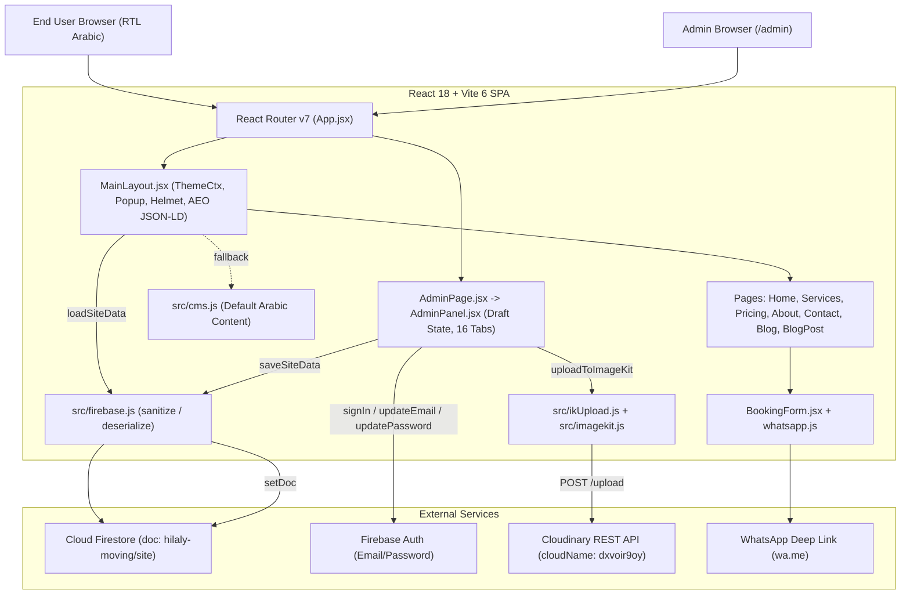
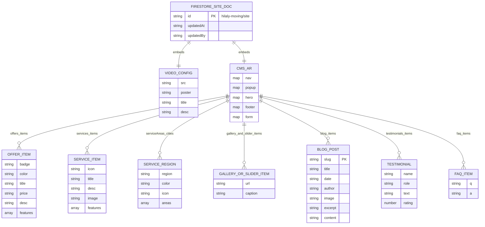

# Hilaly Moving (`hilaly-moving`) — Comprehensive Technical Documentation

> **Brand:** الهلالي لنقل الاثاث (Hilaly Moving)  
> **Production Domain:** `https://hilalymoving.com`  
> **Admin Route:** `/admin`  
> **Primary Language / Direction:** Arabic (`ar`, `dir="rtl"`)  
> **Repository Root:** `d:\hilalyMoving`

---

## Table of Contents

1. [Project Overview](#1-project-overview)
2. [Architecture & Structure](#2-architecture--structure)
3. [Setup & Installation](#3-setup--installation)
4. [Core Modules / Components](#4-core-modules--components)
5. [API Documentation](#5-api-documentation)
6. [Database Schema](#6-database-schema)
7. [Configuration & Deployment](#7-configuration--deployment)
8. [Known Issues, TODOs & Technical Debt](#8-known-issues-todos--technical-debt)
9. [Glossary](#9-glossary)

---

## 1. Project Overview

### What the Project Does & Purpose
**Hilaly Moving** (`hilaly-moving`) is a client-rendered, static-prerendered Single Page Application (SPA) built for **الهلالي لنقل الاثاث**, a residential and commercial furniture moving company operating across Egypt (Greater Cairo, New Cairo, Sheikh Zayed & 6th of October, Alexandria, the Nile Delta, Upper Egypt, and the Suez Canal region).

Its primary business goals are:
1. **WhatsApp-First Lead Generation:** Convert site visitors into structured WhatsApp quote requests without requiring a custom backend booking server.
2. **Local SEO & AEO (Answer Engine Optimization):** Target Egyptian city and neighborhood moving keywords via dedicated routes, a city-searchable coverage section, a localized blog, and embedded Schema.org JSON-LD structured data (`MovingCompany`, `LocalBusiness`, `BreadcrumbList`, `FAQPage`, `Service`, `Product`/`Review`, `HowTo`, `WebPage`/`SpeakableSpecification`).
3. **Self-Service Content Management:** Allow a non-technical site administrator to edit copy, pricing packages, services, gallery images, promotional video, slider images, blog posts, contact numbers, and admin credentials from `/admin`, backed by Firebase Auth, Cloud Firestore, and Cloudinary.

### Target Users
- **End Customers (Moving Clients):** Arabic-speaking households and businesses in Egypt looking for door-to-door furniture moving, packing, carpentry disassembly/reassembly, hydraulic crane lifting (`ونش هيدروليكي`), vehicle/art transport, or international relocation.
- **Site Administrator / Business Owner:** Authenticated via Firebase Auth at `/admin` to update site content and upload media.

### High-Level Architecture Summary
The application is a **React 18 + Vite 6** SPA with **zero custom backend servers**. On initial load, `MainLayout` (or `AdminPage` for `/admin`) fetches a single JSON-like document (`hilaly-moving/site`) from **Cloud Firestore**. If Firestore returns data, it is deep-merged over hardcoded Arabic defaults in `src/cms.js`; if Firestore is unreachable, the app falls back to `localStorage` (`nq_content`, `nq_video`) and ultimately to `src/cms.js`. Media uploaded through `/admin` is sent directly from the browser to **Cloudinary's** unsigned upload REST API, and the resulting `secure_url` is stored in Firestore. Customer booking requests are formatted client-side into a WhatsApp message and opened via `https://wa.me/...`.

### Tech Stack & Exact Installed Dependencies

| Category | Technology | Declared (`package.json`) | Locked (`package-lock.json`) | Purpose |
|---|---|---|---|---|
| **UI Library** | React & React DOM | `^18.2.0` | `18.3.1` | Component rendering & hooks |
| **Routing** | `react-router-dom` | `^7.18.0` | `7.18.0` | Client-side routing (`/`, `/services`, `/pricing`, `/about`, `/contact`, `/blog`, `/blog/:slug`, `/admin`) |
| **SEO Head Mgmt** | `react-helmet-async` | `^3.0.0` | `3.0.0` | Per-route `<title>`, `<meta name="description">`, and `<link rel="canonical">` |
| **BaaS / DB & Auth** | `firebase` | `^12.15.0` | `12.15.0` | Cloud Firestore (`hilaly-moving/site`) + Firebase Auth (Email/Password) |
| **Build Tool** | `vite` | `^6.4.3` | `6.4.3` | Dev server, ESM bundling, Rollup production build |
| **Vite Plugin** | `@vitejs/plugin-react` | `^4.7.0` | `4.7.0` | React Fast Refresh & JSX transform |
| **CSS / Styling** | `tailwindcss` | `^3.4.1` | `3.4.1` | Utility CSS (used minimally; most styling uses inline style objects + `ThemeCtx`) |
| **CSS Processing** | `postcss` / `autoprefixer` | `^8.5.9` / `^10.5.0` | `8.5.9` / `10.5.0` | CSS compilation and vendor prefixing |
| **Media CDN** | Cloudinary REST API | External HTTP | — | Unsigned image (≤10 MB) and video (≤100 MB) uploads and CDN delivery |
| **Fonts** | Google Fonts (`Cairo`, `Inter`) | CDN in `index.html` | — | Arabic (`Cairo`) and Latin (`Inter`) typography |

---

## 2. Architecture & Structure

### Folder & File Breakdown

```text
hilalyMoving/
├── index.html                  # HTML shell, static JSON-LD schemas, OG/Twitter tags, fonts, #app-loading splash
├── package.json                # Scripts (dev, build, preview) and dependencies
├── package-lock.json           # Locked dependency tree
├── vite.config.js              # Vite + React plugin + manual vendor chunking
├── tailwind.config.js          # Tailwind content globs, class dark mode, CSS-var brand tokens
├── postcss.config.js           # PostCSS plugins (tailwindcss, autoprefixer)
├── firestore.rules             # Firestore security rules (public read, single-UID write on hilaly-moving/site)
├── vercel.json                 # Cache-Control headers for /images/*, /_next/static/*, /favicon.ico
├── .gitignore                  # Ignores node_modules, dist, .vite, .env, SecuritySkills/, final revision.mp4
├── public/
│   ├── _redirects              # Netlify / Cloudflare Pages SPA fallback (`/* /index.html 200`)
│   ├── robots.txt              # Crawler allow/disallow rules and sitemap pointer
│   ├── sitemap.xml             # Static XML sitemap (6 top-level routes)
│   ├── favicon.svg             # Primary SVG favicon
│   ├── favicon.jpg             # Legacy/tile image favicon
│   └── favicon-{48,96,192}.png # Multi-size PNG favicons for search/touch icons
├── scripts/
│   ├── prerender.cjs           # Post-build script copying dist/index.html to 5 route directories
│   └── download-images.js      # Standalone image-to-WebP downloader (requires axios & sharp, not installed)
├── src/
│   ├── main.jsx                # React root mounting <BrowserRouter><App /></BrowserRouter>
│   ├── App.jsx                 # Route table: MainLayout outlet routes + standalone /admin route
│   ├── index.css               # Tailwind directives, :root / .dark CSS variables, base body font
│   ├── cms.js                  # Default Arabic CMS payload (CMS.ar) — single source of truth for fallbacks
│   ├── firebase.js             # Firebase init, offline warning filter, loadSiteData/saveSiteData + sanitize/deserialize
│   ├── imagekit.js             # Exports IK_CONFIG (actually holds Cloudinary cloudName + apiKey)
│   ├── ikUpload.js             # Exports uploadToImageKit() (uploads via Cloudinary unsigned upload API)
│   ├── theme.js                # THEMES.light / THEMES.dark tokens, ThemeCtx, useTheme()
│   ├── whatsapp.js             # buildWAMessage(formState, lang) formatter
│   ├── Reveal.jsx              # useReveal() IntersectionObserver hook + <Reveal> transition wrapper
│   ├── layouts/
│   │   └── MainLayout.jsx      # Data loader, mergeCMS, dark mode, popup timer, AEO JSON-LD, NavBar/Outlet/Footer
│   ├── pages/
│   │   ├── Home.jsx            # / — Composes all landing page sections + BookingForm
│   │   ├── Services.jsx        # /services — Services hero, card grid, BookingForm
│   │   ├── Pricing.jsx         # /pricing — Offers grid, pricing factors grid, BookingForm
│   │   ├── About.jsx           # /about — Brand story, 4 stats, guarantees, BookingForm
│   │   ├── Contact.jsx         # /contact — 5 contact cards + #booking BookingForm
│   │   ├── Blog.jsx            # /blog — Article card grid from t.blog.items
│   │   ├── BlogPost.jsx        # /blog/:slug — Article reader matched by slug + WhatsApp CTA
│   │   └── AdminPage.jsx       # /admin — Loads Firestore data, merges CMS defaults, renders AdminPanel
│   └── components/
│       ├── NavBar.jsx          # Fixed top ticker bar + desktop/mobile nav + dark mode toggle
│       ├── HeroSection.jsx     # Full-viewport hero, headline, CTAs, stats, touch-enabled image slider
│       ├── VideoSection.jsx    # IntersectionObserver autoplay video player with blocked-autoplay fallback
│       ├── Sections.jsx        # OffersSection, ServicesSection, PricingSection, GallerySection, TestimonialsSection, ServiceAreasSection
│       ├── FAQSection.jsx      # Accordion FAQ + dynamic FAQPage JSON-LD
│       ├── BookingForm.jsx     # Quote form validating required fields & opening WhatsApp link
│       ├── Footer.jsx          # Brand tagline, social links, 4 phone links, email, copyright
│       ├── SectionHeader.jsx   # Shared centered title + subtitle wrapped in <Reveal>
│       ├── Image.jsx           # Wrapper around  setting loading, fetchpriority, decoding
│       └── AdminPanel.jsx      # Firebase Auth login + 16-tab CMS editor + Cloudinary uploader + credential settings
├── docs/
│   ├── website-documentation.md # Earlier documentation snapshot (partially outdated)
│   └── DOCUMENTATION.md        # This comprehensive technical documentation
├── Blogs Photos/               # Local untracked raw blog image assets
├── services photos/            # Local raw service image assets
├── reports/                    # SEO and competitor analysis reports
├── .kiro/, .claude/, .vscode/  # Editor and AI agent workspace configuration
└── {src,public}/               # Empty stray directory
```

### Data Flow

#### 1. Public Site Read Flow
```text
Browser loads / (or /services, /pricing, /about, /contact, /blog, /blog/:slug)
  └─> main.jsx renders <BrowserRouter><App /></BrowserRouter>
        └─> App.jsx matches <MainLayout />
              ├─> Shows #app-loading / inline gold spinner while loading === true
              └─> useEffect() dynamically imports ../firebase -> loadSiteData()
                    ├─> Success (Firestore doc exists): deserialize(snap.data()) -> mergeCMS(data.content) + setVideo(data.video)
                    ├─> Null / Offline error: reads localStorage ('nq_content', 'nq_video') -> mergeCMS(...)
                    └─> No localStorage: uses hardcoded CMS from src/cms.js
              └─> Passes { t, th, lang, scrollTo, video } via React Router <Outlet context={...} />
                    └─> Page components read t.* via useOutletContext() and th via useOutletContext() or useTheme()
```

#### 2. Lead Generation (Booking) Flow
```text
User fills BookingForm (name, phone, from, to, date required; rooms, floor, services[], notes optional)
  └─> Clicks Submit -> busy = true (700ms delay)
        └─> buildWAMessage(f, lang) builds formatted Arabic/English WhatsApp message
        └─> Reads destination phone from t.footer.phone1 (fallback: '201012345678'), strips non-digits
        └─> window.open(`https://wa.me/${waNumber}?text=${encodeURIComponent(msg)}`, '_blank')
```

#### 3. Admin Write & Media Upload Flow
```text
Admin navigates to /admin -> AdminPage.jsx loads Firestore data -> mergeAdminCMS() -> renders AdminPanel.jsx
  └─> Firebase Auth onAuthStateChanged() checks session
        ├─> Unauthenticated: Email/Password login via signInWithEmailAndPassword()
        └─> Authenticated: Clones content -> draft, video -> videoDraft, dirty = false
              ├─> Media upload: IKUploadBtn / IKVideoUploadBtn -> uploadToImageKit(file, folder)
              │     └─> Base64 Data URL -> POST https://api.cloudinary.com/v1_1/dxvoir9oy/{image|video}/upload
              │     └─> Returns secure_url -> updates draft or videoDraft, sets dirty = true
              └─> Click "حفظ في قاعدة البيانات" -> updates parent state -> saveSiteData(draft, videoDraft)
                    └─> Strips data: video > 500,000 chars -> appends updatedAt & updatedBy -> sanitize() -> setDoc('hilaly-moving/site')
```

### Key Design Patterns & Rationale
- **Centralized Fallback CMS (`src/cms.js`) + Shallow/Sectional Merge (`mergeCMS`):** Ensures the site renders immediately even offline, during Firestore timeouts, or when new fields are added in code before being saved in Firestore.
- **Dynamic Code-Splitting for Firebase (`import('../firebase')` & `import('firebase/auth')`):** Keeps the initial public bundle smaller by deferring Firebase SDK initialization and Auth modules until needed.
- **Draft / Dirty-State Pattern in `AdminPanel.jsx`:** Edits mutate a deep-cloned `draft` state rather than triggering a Firestore write on every keystroke, reducing Firestore write costs and allowing a one-click `discard()`.
- **Context + Token-Based Theming (`ThemeCtx` + `THEMES`):** Components consume `useTheme()` instead of scattering hardcoded dark/light conditionals; light/dark preference persists in `localStorage` (`nq_dark`).
- **Firestore Array Flattening (`sanitize` / `deserialize`):** Cloud Firestore prohibits nested arrays (e.g., `hero.stats: [[value, label], ...]`). `firebase.js` transparently converts 2D arrays to `{ k, v }` object arrays on write and restores `stats` back to `[k, v]` tuples on read.
- **Post-Build Route Directory Prerendering (`scripts/prerender.cjs`):** Copies `dist/index.html` into `/services/`, `/contact/`, `/about/`, `/pricing/`, `/blog/` so static hosts without rewrite support can still serve HTTP 200 for top-level routes.

### System Architecture Diagram



---

## 3. Setup & Installation

### Prerequisites
- **Node.js:** v18+ or v20+ recommended (required by Vite 6 and React Router v7).
- **npm:** Included with Node.js (uses `package-lock.json` lockfile v3).
- **Accounts / Services (only needed if modifying backend configuration):**
  - **Firebase Project:** `helaly-moving` (Firestore database + Email/Password Authentication enabled). Only the UID specified in `firestore.rules` (`q15mMz7v0IbKk2AkOwv4QEkZxwf1`) can write to `hilaly-moving/site`.
  - **Cloudinary Account:** Cloud name `dxvoir9oy` with unsigned upload preset `"store folder"` configured for `Auto` resource type (images and videos).

### Step-by-Step Local Setup

1. **Clone the repository:**
   ```bash
   git clone <repository-url>
   cd hilalyMoving
   ```
2. **Install dependencies:**
   ```bash
   npm install
   ```
3. **Configure services (optional — pre-configured for `helaly-moving`):**
   - Firebase configuration is embedded directly in `src/firebase.js`.
   - Cloudinary configuration is embedded directly in `src/imagekit.js` and `src/ikUpload.js`.
   - Default fallback CMS copy and phone numbers live in `src/cms.js`.
4. **Start the development server:**
   ```bash
   npm run dev
   ```
   Vite serves the application locally (default `http://localhost:5173`).
5. **Build for production:**
   ```bash
   npm run build
   ```
   Runs `vite build` followed by `node scripts/prerender.cjs`, outputting to `dist/`.
6. **Preview the production build locally:**
   ```bash
   npm run preview
   ```

### Environment Variables
**None.** There are currently **no** `.env` files, `process.env.*`, or `import.meta.env.*` variables read anywhere in `src/` or `scripts/`. (`.gitignore` lists `.env` and `.env.local`, but the codebase hardcodes all service configs.)

| Hardcoded Config | Location | Current Value / Purpose |
|---|---|---|
| `firebaseConfig` | `src/firebase.js` (lines 4–13) | Firebase project `helaly-moving` client credentials (`apiKey`, `authDomain`, `databaseURL`, `projectId`, `storageBucket`, `messagingSenderId`, `appId`, `measurementId`) |
| `IK_CONFIG.cloudName` | `src/imagekit.js` (line 4) | `'dxvoir9oy'` — Cloudinary cloud name |
| `IK_CONFIG.apiKey` | `src/imagekit.js` (line 5) | `'SOipLMq61OSi8lMQQwYTIf3BFpE'` — Stored in config (unused by `ikUpload.js`) |
| `upload_preset` | `src/ikUpload.js` (line 28) | `'store folder'` — Cloudinary unsigned upload preset |
| Admin UID | `firestore.rules` (line 7) | `'q15mMz7v0IbKk2AkOwv4QEkZxwf1'` — Sole UID authorized to write `hilaly-moving/site` |

### Running Tests
There is **no test suite** configured in this project:
- `package.json` contains no `test` script and no testing libraries (Jest, Vitest, React Testing Library, Playwright, or Cypress).
- Verification is currently manual (via `npm run dev` / `npm run preview` and browser inspection).

---

## 4. Core Modules / Components

### Data, Utility & Service Modules (`src/`)

#### `src/firebase.js`
- **Responsibility:** Initializes the Firebase app and Firestore client, suppresses Firestore offline console warnings, and handles reading/writing the single site document `hilaly-moving/site`.
- **Public Functions:**
  - `loadSiteData(): Promise<{ content: object, video: object, updatedAt?: string, updatedBy?: string } | null>`
    Fetches `doc(db, 'hilaly-moving', 'site')`, passes it through `deserialize()`, and returns `null` if missing or on network/permission error.
  - `saveSiteData(content: object, video: object): Promise<boolean>`
    Strips `video.src` if it is a `data:` URI exceeding `500,000` characters, dynamically imports `firebase/auth` to record `updatedBy` (`user.email || user.uid`, defaulting to `'unknown'`), adds `updatedAt` (ISO string), sanitizes via `sanitize()`, and writes with `setDoc()`. Returns `true` on success, `false` on error.
- **Internal Helpers & Rules:**
  - `sanitize(obj)`: JSON round-trip replacing `undefined` with `null` and converting nested arrays (`[['a', 'b']]`) into `{ k: 'a', v: 'b' }` objects so Firestore accepts them.
  - `deserialize(obj)`: Restores arrays under key `'stats'` from `[{ k, v }]` back to `[[k, v]]` tuples.
- **Usage Example:**
  ```js
  import { loadSiteData, saveSiteData } from './firebase'

  const data = await loadSiteData()
  if (data) console.log(data.content.ar.hero)

  const ok = await saveSiteData(updatedContent, videoObj)
  ```

#### `src/ikUpload.js` & `src/imagekit.js`
- **Responsibility:** Client-side validation, base64 encoding, and unsigned upload of images and videos to **Cloudinary** (historically named after ImageKit).
- **Public Exports:**
  - `IK_CONFIG` (`src/imagekit.js`): `{ cloudName: 'dxvoir9oy', apiKey: 'SOipLMq61OSi8lMQQwYTIf3BFpE' }`.
  - `uploadToImageKit(file: File, folder?: string, resourceType?: string): Promise<{ url: string, fileId: string, name: string, filePath: string }>`
    - Defaults: `folder = 'store'`, `resourceType = 'auto'` (note: `resourceType` parameter is currently ignored; resource is derived from `file.type.startsWith('video/')`).
    - Size limits enforced before upload: **10 MB** for images (`10 * 1024 * 1024`), **100 MB** for videos (`100 * 1024 * 1024`).
    - Reads file via `FileReader.readAsDataURL`, posts `FormData` with `upload_preset: 'store folder'` to `https://api.cloudinary.com/v1_1/dxvoir9oy/${resource}/upload`.
- **Usage Example:**
  ```js
  import { uploadToImageKit } from '../ikUpload'

  const { url } = await uploadToImageKit(file, '/hilaly-moving/gallery')
  ```

#### `src/cms.js`
- **Responsibility:** Exports `CMS` (`{ ar: { ... } }`), the hardcoded Arabic default dataset used as the initial state and fallback when Firestore/localStorage fields are absent.
- **Top-Level Sections under `CMS.ar`:** `nav`, `popup`, `slider`, `hero`, `offers`, `serviceAreas`, `services`, `specialServices`, `pricing`, `gallery`, `testimonials`, `trust`, `faq`, `howItWorks`, `form`, `blog`, `footer`.

#### `src/theme.js`
- **Responsibility:** Light/dark color palettes and React Context provider/hook.
- **Exports:** `THEMES` (`{ light, dark }`, each with 17 tokens: `bg`, `bgCard`, `bgNav`, `bgSection`, `bgHero`, `text`, `textMuted`, `border`, `accent`, `accentLight`, `accentText`, `green`, `shadow`, `shadowSm`), `ThemeCtx`, and `useTheme()`.

#### `src/whatsapp.js`
- **Responsibility:** Formats booking form submissions into WhatsApp messages.
- **Public Function:**
  - `buildWAMessage(f: { name, phone, from, to, date, rooms, floor, services?: string[], notes?: string }, lang: 'ar' | string): string`
    Generates an emoji-formatted Arabic (`lang === 'ar'`) or English quote request summary, omitting empty optional lines (`services`, `notes`).

#### `src/Reveal.jsx`
- **Responsibility:** Scroll-triggered entrance animations using native `IntersectionObserver`.
- **Exports:**
  - `useReveal(): [React.RefObject, boolean]` — Triggers once at `threshold: 0.1`, then disconnects observer.
  - `Reveal({ children, delay = 0, dir = 'up', style = {} })` — Supports `dir` values `'up' | 'down' | 'left' | 'right'` (`36px` translate).

### Layout, Pages & UI Components

| Component / Page | File | Responsibility & Key Props / State |
|---|---|---|
| `MainLayout` | `src/layouts/MainLayout.jsx` | Fetches Firestore site data on mount, runs `mergeCMS()`, manages `dark` (`nq_dark`), renders promotional popup countdown, injects `HowTo` and `WebPage` JSON-LD, wraps `<Outlet context={{ t, th, lang, scrollTo, video }} />` with `NavBar` and `Footer`. |
| `NavBar` | `src/components/NavBar.jsx` | Props: `{ lang, dark, setDark, t, scrollTo }`. Renders 34px scrolling ticker bar (4 phones + active social links), desktop links (`/` , `/services`, `/blog`, `/pricing`, `/contact`), theme toggle, CTA link, and mobile (<640px) slide-in drawer with quick WhatsApp/Call actions. |
| `HeroSection` | `src/components/HeroSection.jsx` | Props: `{ t, scrollTo }`. Full-viewport hero with animated badge, 2-line split headline, CTA scrolling to `#contact`, call link, 3 stats, and auto-advancing (5s) swipeable image slider (`slider.items` with fallback `DEFAULT_SLIDER_ITEMS`). |
| `VideoSection` | `src/components/VideoSection.jsx` | Props: `{ video }`. Returns `null` if `!video?.src`. Autoplays muted inline video via `IntersectionObserver` (`threshold: 0.3`); displays play overlay and tap hint if mobile/iOS blocks autoplay. |
| `Sections.jsx` | `src/components/Sections.jsx` | Exports 6 section components: `OffersSection({ t })` (3 pricing tiers), `ServicesSection({ t })` (cards + `Service` JSON-LD), `PricingSection({ t })` (6 pricing factors + 4-step breakdown), `GallerySection({ t })` (desktop 12-col bento / mobile 2-col grid + lightbox modal), `TestimonialsSection({ t })` (5s auto-rotating quote + `Product`/`Review` JSON-LD), `ServiceAreasSection({ t })` (live area search + expandable region cards + `MovingCompany` JSON-LD). |
| `FAQSection` | `src/components/FAQSection.jsx` | Props: `{ t }`. Accordion FAQ list + dynamic `FAQPage` JSON-LD schema. |
| `BookingForm` | `src/components/BookingForm.jsx` | Props: `{ t, lang }`. Section `#contact`. Validates required fields (`name`, `phone`, `from`, `to`, `date`), toggles service chips, builds WhatsApp link via `buildWAMessage` using `t.footer.phone1`. |
| `Footer` | `src/components/Footer.jsx` | Props: `{ t }`. Displays brand, tagline, active social links (`facebook`, `instagram`, `whatsapp`, `tiktok`), 4 phone links, email, and copyright. |
| `SectionHeader` | `src/components/SectionHeader.jsx` | Props: `{ title, sub }`. Centered heading wrapped in `<Reveal>`. |
| `Image` | `src/components/Image.jsx` | Props: `{ src, alt, width, height, priority, style, className }`. Sets `loading="eager"`/`fetchpriority="high"`/`decoding="sync"` when `priority={true}`, otherwise `loading="lazy"`/`decoding="async"`. |
| `AdminPage` | `src/pages/AdminPage.jsx` | Loads Firestore data on mount via `loadSiteData()`, merges via `mergeAdminCMS()`, renders `AdminPanel` with exit navigation to `/`. |
| `AdminPanel` | `src/components/AdminPanel.jsx` | Props: `{ content, setContent, video, setVideo, onExit }`. Firebase Auth gate (`onAuthStateChanged`, `signInWithEmailAndPassword`), 16-tab editor (`contacts`, `hero`, `media`, `popup`, `slider`, `services`, `offers`, `special`, `testimonials`, `pricing`, `trust`, `how`, `faq`, `form`, `blog`, `settings`), Cloudinary upload buttons, and `reauthenticateWithCredential` + `updateEmail`/`updatePassword` settings form. |

---

## 5. API Documentation

This project has **no custom backend HTTP endpoints**. All remote communication occurs directly from the browser against **Firebase** (Firestore + Auth), **Cloudinary** (Upload API), and **WhatsApp** (`wa.me` deep links).

### 1. Cloud Firestore Document API (via Firebase SDK v12)

| Operation | Function | Target Path | Auth Required | Notes |
|---|---|---|---|---|
| **Read Site Content** | `getDoc(doc(db, 'hilaly-moving', 'site'))` via `loadSiteData()` | `databases/(default)/documents/hilaly-moving/site` | No (`allow read: if true`) | Returns `{ content, video, updatedAt, updatedBy }` or `null` |
| **Write Site Content** | `setDoc(doc(db, 'hilaly-moving', 'site'), ...)` via `saveSiteData()` | `databases/(default)/documents/hilaly-moving/site` | Yes (`request.auth.uid == 'q15mMz7v0IbKk2AkOwv4QEkZxwf1'`) | Overwrites full document; strips `data:` video URIs >500,000 chars |

### 2. Firebase Authentication (via `firebase/auth`)

| Operation | SDK Call | Trigger Location |
|---|---|---|
| **Session Observer** | `onAuthStateChanged(getAuth(), cb)` | `AdminPanel.jsx` on mount |
| **Admin Login** | `signInWithEmailAndPassword(getAuth(), email, pwd)` | `AdminPanel.jsx` login form |
| **Re-authenticate** | `reauthenticateWithCredential(user, EmailAuthProvider.credential(...))` | `AdminPanel.jsx` Settings tab before email/password update |
| **Update Email / Password** | `updateEmail(user, newEmail)` / `updatePassword(user, newPwd)` | `AdminPanel.jsx` Settings tab |

### 3. Cloudinary Unsigned Upload REST API

- **Method & URL:** `POST https://api.cloudinary.com/v1_1/dxvoir9oy/{resource}/upload` where `{resource}` is `'video'` (if `file.type.startsWith('video/')`) or `'image'`.
- **Auth:** None (uses unsigned upload preset `'store folder'`).
- **Request Body (`multipart/form-data`):**
  | Field | Type | Example / Value |
  |---|---|---|
  | `file` | string (Data URI) | `data:image/jpeg;base64,/9j/4AAQ...` |
  | `upload_preset` | string | `"store folder"` |
  | `folder` | string | `"/hilaly-moving/gallery"` or `"/hilaly-moving/videos"` (defaults to `"store"`) |
- **Success Response (`200 OK`):**
  ```json
  {
    "secure_url": "https://res.cloudinary.com/dxvoir9oy/image/upload/v1234567890/hilaly-moving/gallery/photo.jpg",
    "public_id": "hilaly-moving/gallery/photo",
    "original_filename": "photo"
  }
  ```
  `uploadToImageKit()` maps this to `{ url: result.secure_url, fileId: result.public_id, name: result.original_filename, filePath: result.public_id }`.
- **Error Response (`4xx`/`5xx`):** Throws `Error(error.error?.message || 'Upload failed')`.

### 4. WhatsApp Lead Link

- **Format:** `https://wa.me/{digitsOnlyPhone}?text={encodeURIComponent(message)}`
- **Used in:** `BookingForm.jsx` (quote submission), `NavBar.jsx` (mobile drawer quick chat), `BlogPost.jsx` (article inquiry CTA).

---

## 6. Database Schema

Cloud Firestore operates in schemaless document mode with a **single document** store:

- **Collection:** `hilaly-moving`
- **Document ID:** `site`
- **Security Rules (`firestore.rules`):**
  ```javascript
  rules_version = '2';
  service cloud.firestore {
    match /databases/{database}/documents {
      match /hilaly-moving/site {
        allow read: if true;
        allow write: if request.auth != null
          && request.auth.uid == 'q15mMz7v0IbKk2AkOwv4QEkZxwf1';
      }
    }
  }
  ```

### Document Structure (`hilaly-moving/site`)

| Top-Level Field | Type | Description |
|---|---|---|
| `content` | `map` | Contains `ar` key holding all CMS sections (`CMS.ar`) |
| `video` | `map` | `{ src: string, poster: string, title: string, desc: string }` |
| `updatedAt` | `string` | ISO-8601 timestamp written by `saveSiteData()` |
| `updatedBy` | `string` | Authenticated admin's email or UID (`'unknown'` fallback) |

#### `content.ar` Sub-Schema

| Key | Fields & Types |
|---|---|
| `nav` | `{ brand: string, logo: string, book: string }` |
| `popup` | `{ enabled: boolean, title: string, desc: string, button: string, timerHours: number, bgImage: string }` |
| `slider` | `{ title: string, items: Array<{ url: string, caption: string }> }` |
| `hero` | `{ badge: string, headline: string, sub: string, cta: string, stats: Array<{ k: string, v: string }> }` *(deserialized in JS to `[string, string][]`)* |
| `offers` | `{ title: string, sub: string, items: Array<{ badge: string, color: string, title: string, price: string, desc: string, features: string[] }> }` |
| `serviceAreas` | `{ title: string, sub: string, cities: Array<{ region: string, color: string, icon: string, areas: string[] }> }` |
| `services` | `{ title: string, sub: string, items: Array<{ icon: string, title: string, desc: string, image: string, features: string[] }> }` |
| `specialServices` | `{ title: string, sub: string, items: Array<{ icon: string, title: string, desc: string, tag: string }> }` |
| `pricing` | `{ title: string, sub: string, factors: Array<{ icon: string, label: string, desc: string, bg: string, col: string }> }` |
| `gallery` | `{ title: string, sub: string, items: Array<{ url: string, caption: string }> }` |
| `testimonials` | `{ title: string, sub: string, items: Array<{ name: string, role: string, text: string, rating: number }> }` |
| `trust` | `{ title: string, sub: string, badges: Array<{ icon, num, label, desc }>, guarantees: Array<{ icon, title, desc }> }` |
| `faq` | `{ title: string, sub: string, items: Array<{ q: string, a: string }> }` *(Note: currently overridden by `CMS.ar.faq` on read!)* |
| `howItWorks` | `{ title: string, sub: string, steps: Array<{ num, icon, title, desc }> }` |
| `form` | `{ title, sub, name, namePh, phone, phonePh, from, fromPh, to, toPh, date, rooms, roomsOpts: string[], floor, floorPh, services, servicesOpts: string[], notes, notesPh, submit, submitting }` |
| `blog` | `{ title: string, sub: string, items: Array<{ title, slug, date, image, excerpt, content, author }> }` |
| `footer` | `{ tag, phone1, phone2, phone3, phone4, email, copy, social: { facebook, instagram, whatsapp, tiktok } }` |

### Entity-Relationship Diagram



### Constraints & Limits
- **Firestore 1 MiB Document Limit:** Because the entire site CMS lives in a single document (`hilaly-moving/site`), `saveSiteData()` explicitly discards base64 `data:` strings larger than `500,000` characters on `video.src`. Uploading images via Cloudinary keeps image payloads as short URLs.
- **No Indexes Needed:** Only single-document key lookups (`getDoc`) are performed; no collection queries or composite indexes are used.

---

## 7. Configuration & Deployment

### Build & Prerender Pipeline
- `npm run build` executes `vite build && node scripts/prerender.cjs`.
- `vite.config.js` configures `@vitejs/plugin-react` and splits `react` + `react-dom` into a dedicated `vendor` Rollup chunk.
- `scripts/prerender.cjs` verifies `dist/index.html` exists and copies it into `dist/services/index.html`, `dist/contact/index.html`, `dist/about/index.html`, `dist/pricing/index.html`, and `dist/blog/index.html`. (Note: `/blog/:slug` and `/admin` rely on SPA fallback rules rather than prerendered folders.)

### Configuration Files Reference

| File | What It Controls |
|---|---|
| `vite.config.js` | React plugin, Rollup `manualChunks: { vendor: ['react', 'react-dom'] }` |
| `tailwind.config.js` | Content scan paths (`./index.html`, `./src/**/*.{js,ts,jsx,tsx}`), `darkMode: 'class'`, `brand.*` color/gradient/shadow CSS variables, `fontFamily.cairo` |
| `postcss.config.js` | Enables `tailwindcss` and `autoprefixer` |
| `index.html` | Root HTML shell, `lang="ar" dir="rtl"`, static SEO meta tags, Open Graph/Twitter cards, 4 static JSON-LD schemas (`MovingCompany`, `LocalBusiness`, `BreadcrumbList`, `FAQPage`), Google Fonts (`Inter`, `Cairo`), `#app-loading` CSS/HTML splash, `<noscript>` Arabic fallback |
| `public/_redirects` | Netlify / Cloudflare Pages SPA fallback: `/*    /index.html   200` |
| `public/robots.txt` | Allows crawlers, disallows `/*?admin=*`, declares crawl delay (`1`) and sitemap URL |
| `public/sitemap.xml` | Lists 6 routes (`/`, `/services`, `/pricing`, `/contact`, `/about`, `/blog`) for `https://hilalymoving.com` |
| `vercel.json` | Sets `Cache-Control: public, max-age=31536000, immutable` on `/images/(.*)`, `/_next/static/(.*)`, and `/favicon.ico` |
| `firestore.rules` | Firestore access control (public read, single-UID write) |
| `.vscode/launch.json` | Chrome debug config targeting `http://localhost:8080` |

### Hosting & Environment Differences
- **Hosting Targets:** Static SPA hosting compatible with **Cloudflare Pages** (referenced in commit `6165fa8` upgrading Vite to v6), **Netlify** (`public/_redirects`), or **Vercel** (`vercel.json`). No CI/CD workflow files (`.github/workflows/`) exist in the repository.
- **Dev vs. Production Differences:**
  - `npm run dev` serves unbundled ESM modules on Vite's dev server (default port `5173`) without `prerender.cjs`.
  - `npm run build` produces minified chunks in `dist/` and creates static route directories for 5 routes.
  - There is **no staging/production Firebase project separation** — both local dev and production builds point to the same `helaly-moving` Firestore document (`hilaly-moving/site`).

---

## 8. Known Issues, TODOs & Technical Debt

No `TODO` or `FIXME` comments exist in `src/` (only `+20 XX XXXX XXXX` phone placeholder strings matched `XXX`), but direct inspection of the codebase and git history reveals the following concrete issues and technical debt:

1. **Saved FAQ Edits Are Silently Overwritten (`MainLayout.jsx:22`, `AdminPage.jsx:13`):**
   Both `mergeCMS()` and `mergeAdminCMS()` hardcode `faq: CMS.ar.faq`, discarding any FAQ changes saved to Firestore from the `faq` tab in `AdminPanel.jsx`.
2. **Popup Scroll Target & Dismissal Mismatch (`MainLayout.jsx:69-84`, `163-173`):**
   - Clicking the popup CTA scrolls to `#booking`, which only exists on `/contact` (`Contact.jsx:48`). On `/`, `/services`, `/pricing`, and `/about`, `BookingForm` uses `id="contact"`, so the scroll does nothing.
   - `AdminPanel.jsx` claims the popup appears *"once per visitor"*, and supports `popup.bgImage`, but `MainLayout.jsx` never persists dismissal in storage, never renders `popup.bgImage`, and adds a hardcoded `43m 49s` to `timerHours` on every mount.
3. **Orphaned / Unrendered CMS Sections & Admin Tabs:**
   - Commit `278ccbb` deleted `SpecialServicesSection.jsx`, `HowItWorksSection.jsx`, and `TrustBadgesSection.jsx`, yet `cms.js` still stores `specialServices`, `howItWorks`, and `trust.badges`, and `AdminPanel.jsx` still exposes tabs for `special`, `how`, and `trust` (only `trust.guarantees` is rendered in `About.jsx`).
   - Conversely, `hero.stats`, `serviceAreas`, `footer.tag`, and `footer.copy` are rendered on the public site but have no editor UI in `AdminPanel.jsx` (after the `footer` tab was removed in `50ddc83`). `AdminPanel.jsx` also edits `hero.ctaSub`, which is neither in `cms.js` nor rendered in `HeroSection.jsx`.
4. **Misleading ImageKit Naming & Unused Config (`src/imagekit.js`, `src/ikUpload.js`, `AdminPanel.jsx`):**
   - `uploadToImageKit` and `IK_CONFIG` actually target **Cloudinary**, while UI strings still say `"ImageKit"`.
   - `IK_CONFIG.apiKey` (`'SOipLMq61OSi8lMQQwYTIf3BFpE'`) is defined in client code and unused by `ikUpload.js` — verify whether this value is sensitive and rotate/remove it if it is a Cloudinary secret rather than a public key.
   - `uploadToImageKit`'s `resourceType` parameter is unused, and `IKVideoUploadBtn`'s `progress` state (`AdminPanel.jsx:51`) is never updated or displayed.
5. **Corrupted Unsplash URLs in `src/cms.js`:**
   Several default URLs in `slider.items` (lines 16–17), `gallery.items` (lines 122–126), and `blog.items` (lines 280, 289) contain malformed hex characters (e.g., `photo-160058515c40-be6c161a56a0c`, `photo-14c84b1521896436-2a19c22b5858`), which will 404 unless overridden in Firestore.
6. **Literal `${search}` Template Bug & Unused Code (`src/components/Sections.jsx`):**
   - Line 851 uses single quotes (`'لم نعثر على "${search}" ...'`), displaying `${search}` literally when a region search returns no matches.
   - `mob` (line 7) and `searchLower` (line 620) are unused.
   - `OffersSection` (line 44) rotates the `"الأفضل"` ribbon `45deg`, whereas `Pricing.jsx` (line 34) rotates it `-45deg`.
   - `HeroSection.jsx` (line 78) sets `flexDirection: isMobile ? 'column' : 'grid'` (`'grid'` is invalid for `flexDirection`).
7. **Theme Token Mismatch (`src/index.css` vs `src/theme.js`):**
   `index.css` defines indigo CSS variables (`#4f46e5` / `#6366f1`), while `theme.js` uses gold (`#B8860B` / `#D4A017`). Most components bypass CSS variables via inline `useTheme()` styles, making `index.css` variables and `tailwind.config.js` `brand` tokens largely unused.
8. **SEO & Deployment Config Drift:**
   - `public/robots.txt` still references the legacy domain `https://helalymoving.tryasp.net/sitemap.xml` and `Disallow: /*?admin=*` (admin moved to `/admin`).
   - `public/sitemap.xml` omits `/blog/:slug` article URLs.
   - `vercel.json` includes an unused `/_next/static/(.*)` cache rule from a Next.js template and `/images/(.*)` even though Vite outputs to `/assets/`.
   - `index.html` sets `<meta name="msapplication-TileImage" content="/favicon.jpg" />` and `<link rel="preconnect" href="https://res.cloudinary.com" />`, while `og:image` uses an Unsplash URL.
   - `scripts/download-images.js` requires `axios` and `sharp`, neither of which is in `package.json`.
   - `docs/website-documentation.md` is stale and documents deleted components and older package versions.
9. **Console Warning Suppression (`src/firebase.js:19-30`):**
   Monkey-patches `console.warn` globally in the browser to hide Firestore offline warnings.
10. **Repository Hygiene & Missing Tests:**
    - Stray empty directory `{src,public}/` exists at the repository root.
    - Large media binaries (`OverView.mp4`, `Blogs Photos/`, `services photos/`) exist in the workspace.
    - Zero automated unit, integration, or E2E tests exist.

---

## 9. Glossary

| Term / Identifier | Meaning in This Codebase |
|---|---|
| **Hilaly Moving / الهلالي لنقل الاثاث** | The Egyptian furniture moving company for which this application is built. |
| **NaqlaPlus (`nq_*`)** | Legacy project/template prefix preserved in `localStorage` keys (`nq_dark`, `nq_content`, `nq_video`) and `README.md` / `PROJECT_DESCRIPTION.md`. |
| **`CMS` (`src/cms.js`)** | Static JavaScript object (`CMS.ar`) holding default Arabic site copy, offerings, service areas, blog posts, and form labels. |
| **`t` & `th`** | Outlet context props passed by `MainLayout.jsx` (`t` = active Arabic CMS object `content.ar`; `th` = active `THEMES.light` or `THEMES.dark` object). |
| **IK / `IK_CONFIG` / `uploadToImageKit`** | Legacy "ImageKit" naming still used in `src/imagekit.js`, `src/ikUpload.js`, and `AdminPanel.jsx`, even though uploads now target **Cloudinary**. |
| **AEO (Answer Engine Optimization)** | JSON-LD schemas (`HowTo`, `SpeakableSpecification`, `Service`, `FAQPage`, `Review`) injected for AI assistants and voice search engines. |
| **GEO (`ServiceAreasSection`)** | Geographic coverage section targeting Egyptian cities/neighborhoods (Cairo, New Cairo, Sheikh Zayed, 6th of October, Alexandria, Delta, Upper Egypt & Canal) with dynamic `MovingCompany` JSON-LD. |
| **Prerendering (`scripts/prerender.cjs`)** | Post-build step that duplicates `dist/index.html` into static folders for `/services`, `/contact`, `/about`, `/pricing`, and `/blog`. |
| **ونش هيدروليكي** | Hydraulic furniture-lifting crane service added in commit `f2f07fd` for moving heavy items to/from upper floors. |
